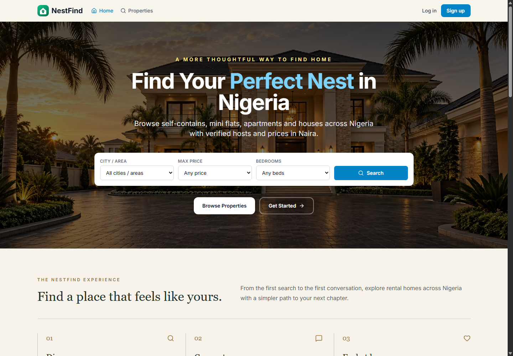
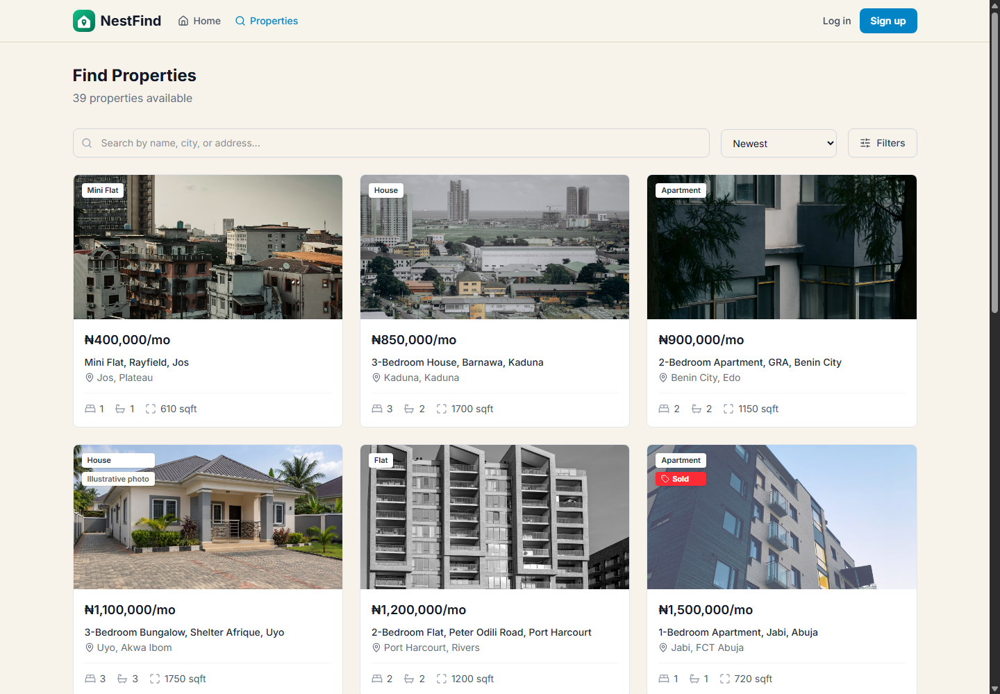

# NestFind

NestFind is a Nigerian real estate application for discovering homes, contacting hosts, and managing bookings and payments.

## Overview

Searching for a home can mean jumping between scattered listings with unclear prices and little information about the host. NestFind brings property search, saved listings, enquiries, bookings, and payment history into one place. Hosts can publish and manage their properties through a separate dashboard.

## Live Demo

- Website: [nest-find-alpha.vercel.app](https://nest-find-alpha.vercel.app/)
- API: [nestfind-backend-ie6m.onrender.com](https://nestfind-backend-ie6m.onrender.com/api/)

## Screenshots

### Home page



### Property search



## Features

- Browse, search, sort, and filter Nigerian property listings by location, price, bedrooms, and type.
- Create an account, verify contact details, save properties, review listings, and send enquiries to hosts.
- Let hosts create listings, upload images, and manage their properties and enquiries.
- Book rentals or purchases, pay through Flutterwave, and view receipts, payment history, and notifications.
- Send AI-written welcome and payment confirmation messages (email and in-app), with fixed text as a fallback. Set `ANTHROPIC_API_KEY` in the backend environment to turn it on.

## Technology Stack

| Layer | Technology |
| --- | --- |
| Frontend | React 19, Vite, React Router, Tailwind CSS, Axios, TanStack Query |
| Backend | Python, Django 6, Django REST Framework, Simple JWT, drf-spectacular |
| Database | PostgreSQL; local SQLite fallback when PostgreSQL is unavailable |
| Testing | Django test runner and DRF API tests; Oxlint for frontend linting |
| Deployment | Vercel frontend, Render API, Cloudinary for production media |

## Architecture

The React frontend calls the Django REST API over HTTPS using Axios. The API authenticates protected requests with JWT bearer tokens, applies role and ownership permissions, and reads and writes application data in PostgreSQL. Property images can be stored in Cloudinary in production. Flutterwave handles payment checkout; the backend verifies transactions before updating bookings.

## Installation

### Prerequisites

- Python 3.12 or newer
- Node.js 20.19 or newer and npm
- PostgreSQL (recommended); the backend falls back to a local SQLite database if PostgreSQL cannot be reached

### Backend setup

```bash
git clone https://github.com/hillaryessien18-droid/NestFind.git
cd NestFind/backend
python -m venv .venv
```

Activate the environment with `source .venv/bin/activate` on macOS/Linux or `.venv\Scripts\Activate.ps1` in PowerShell, then run:

```bash
pip install -r requirements.txt
```

Copy `.env.example` to `.env`. Set `SECRET_KEY` and either `DATABASE_URL` or the `DB_*` PostgreSQL values. The example file lists optional Flutterwave, Cloudinary, email, and CORS settings. For local development, keep `DEBUG=True` and set `CORS_ALLOWED_ORIGINS=http://localhost:5173`.

```bash
python manage.py migrate
python manage.py runserver
```

The API runs at `http://127.0.0.1:8000/api/`.

### Frontend setup

In a second terminal:

```bash
cd NestFind/frontend
npm ci
```

Copy `.env.example` to `.env` and set `VITE_API_BASE_URL=http://localhost:8000/api`, or leave it unset to use Vite's local `/api` proxy. Then run:

```bash
npm run dev
```

Open `http://localhost:5173/`.

## API Documentation

- [Swagger UI](https://nestfind-backend-ie6m.onrender.com/api/docs/)
- [OpenAPI schema](https://nestfind-backend-ie6m.onrender.com/api/schema/)
- [ReDoc](https://nestfind-backend-ie6m.onrender.com/api/redoc/)

Local equivalents are available on port 8000. The API includes account, property, image, review, saved listing, enquiry, dashboard, booking, payment, and notification endpoints.

## Database Design

`User` stores accounts and guest, tenant, or host roles. Each `Property` belongs to a user and can have many `PropertyImage`, `Review`, `Enquiry`, and `Booking` records. Properties and `Amenity` records have a many-to-many relationship. `SavedProperty` joins users and properties, with one save per user and property. Each `Booking` belongs to a user and property, can have multiple `PaymentTransaction` records, and can have one `TenantDetail` record. `Notification` belongs to a user.

## Testing

Run backend tests from `backend/` with the virtual environment active:

```bash
python manage.py test
```

Run frontend lint from `frontend/`:

```bash
npm run lint
```

## Security

The API uses JWT access and refresh tokens for authentication. Protected endpoints enforce role and ownership checks, including host-only listing management. Django and DRF serializers validate request data; password validators, email and phone verification, and password reset flows protect accounts. Production settings enable HTTPS redirects, secure cookies, HSTS, and configured CORS origins. Payment verification runs on the backend, so a browser redirect alone does not confirm a booking. Keep secrets in environment variables and out of the repository.

## Future Improvements

- Add automated frontend component and end-to-end tests.
- Expand map-based search and location filters.
- Improve listing quality controls and host verification.

## Author

[hillaryessien18-droid](https://github.com/hillaryessien18-droid)
